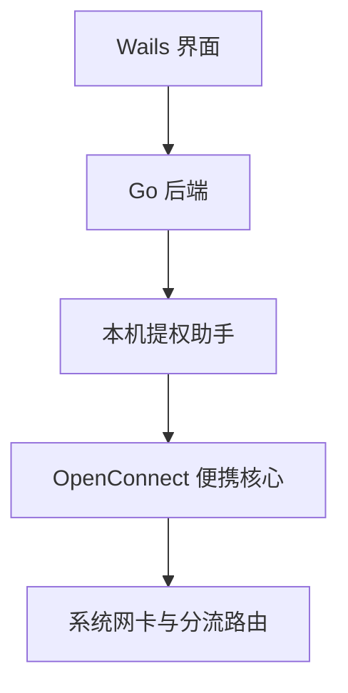

# CUHK VPN · Go + Wails

一个使用 Go 和 Wails 编写的非官方校园 VPN 客户端，默认连接 CUHK(SZ) VPN。提供经典绿屏 CRT 界面、连接状态、日志和可配置分流，同一套源码面向 Windows、macOS 和 Linux。

## 基本原理



1. **准备核心**：根据系统和 CPU 架构下载固定版本的 OpenConnect 及依赖，校验 SHA-256 后解压到应用目录。下载包只用于提取文件，不运行安装器，也不调用系统包管理器。
2. **管理连接**：Go 启动同一程序的提权助手，由助手管理 OpenConnect 进程。界面和助手通过本机会话通信，密码经标准输入传给核心，不放入命令行。
3. **按网段分流**：Windows 使用 JScript，macOS/Linux 使用 Shell 包装官方路由脚本，只让配置的 IPv4 网段通过 VPN。默认转发 `10.20.0.0/16`，其余流量沿原有路由传输，保留系统 DNS。
4. **正常断开**：发送 Ctrl+C / SIGINT，等待核心恢复网卡和路由。Windows 登录前通过原生 IP Helper API 固定物理网关，断开时仅清理本次新建的网关路由。

核心来源和哈希固定在 [`internal/core/sources.json`](internal/core/sources.json)。本项目不重新实现 VPN 协议，也不在源码仓库中保存第三方核心二进制。

## 使用与构建

需要 Go 1.25+ 和各平台的 Wails 开发环境；前端为内置静态资源，无需 npm 构建。

```powershell
# Windows：测试并构建
.\build.ps1 -Test
```

```sh
# macOS / Linux：原生构建
sh build.sh
```

运行 `build/bin/` 下的程序，在设置中填写学校账号和密码，再点击连接。首次使用自动准备便携核心，不需要手动安装 OpenConnect。桌面界面仍依赖系统的 WebView2 或 GTK/WebKit 等运行环境。

- Windows 提供 x64 / ARM64 GUI；ARM64 的 OpenConnect 核心使用系统 x64 仿真。
- Windows 已验证真实学校 VPN 连接；macOS/Linux 的真实连接仍需在对应系统测试。
- 可选记住密码。便携保存模式将加密密钥与密文放在同一个 `data/` 目录，完整目录可迁移，也能被持有者解密；不要上传或转发个人 `data/`。

详细构建步骤、核心来源、平台限制和分发说明见 [`docs/DEVELOPMENT.md`](docs/DEVELOPMENT.md)。本项目并非学校官方客户端。

## 第三方组件

[Wails](https://github.com/wailsapp/wails)、[OpenConnect](https://gitlab.com/openconnect/openconnect)、[vpnc-scripts](https://gitlab.com/openconnect/vpnc-scripts) 和其他依赖保留各自许可证。点阵图标基于 Lucide / Feather，许可见 [`frontend/icons/LICENSE.txt`](frontend/icons/LICENSE.txt)。
